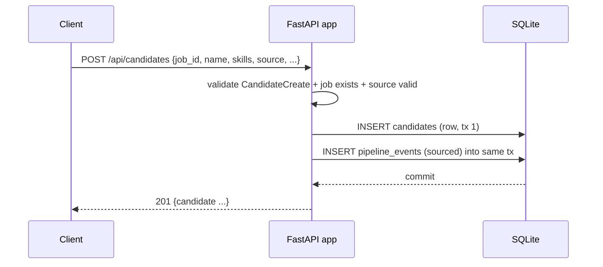

# ScoutForge — Architecture

This document describes how the running system is built, as implemented in the
source tree. ScoutForge is intentionally **small and self-contained**: one Python
process (FastAPI), one SQLite file, and a zero-build browser dashboard. There is
no message queue, no cache, no ORM, and no external AI service.

## Architectural overview

```
┌────────────────────────────────────────────────────────────────────────────┐
│                            BROWSER (user)                                  │
│        vanilla-JS single-page dashboard  (frontend/)                       │
│        index.html · app.js · style.css                                     │
└───────────────────────────────┬────────────────────────────────────────────┘
                                │  HTTP (JSON) — same origin, no CORS needed
┌───────────────────────────────▼────────────────────────────────────────────┐
│                        FASTAPI application  (app/main.py)                  │
│                                                                             │
│   ┌─────────────┐   ┌─────────────┐   ┌─────────────┐   ┌──────────────┐   │
│   │  jobs.router│   │candidates.  │   │pipeline.    │   │ scoring.     │   │
│   │  /api/jobs  │   │router       │   │router       │   │ router       │   │
│   │             │   │/api/        │   │/api/        │   │ /api/jobs/…/ │   │
│   │             │   │candidates   │   │candidates/… │   │ shortlist,   │   │
│   │             │   │             │   │             │   │ candidates/… │   │
│   └──────┬──────┘   └──────┬──────┘   └──────┬──────┘   │ /score       │   │
│          │                 │                 │          └──────┬───────┘   │
│          │                 │                 │          analytics.router   │
│          │                 │                 │          /api/jobs/{id}/    │
│          └─────────────────┴────────┬────────┴───────┬────── analytics      │
│                                     │                │        │            │
│   ┌─────────────────────────────────▼────────────────▼────────▼──────────┐  │
│   │              scoring.py  (pure deterministic engine)                 │  │
│   │              0.6 × skills ratio  +  0.4 × seniority fit              │  │
│   └──────────────────────────────────────────────────────────────────────┘  │
│                                     │                                        │
│   ┌─────────────────────────────────▼─────────────────────────────────────┐ │
│   │              database.py  (sqlite3 stdlib, no ORM)                    │ │
│   │              jobs · candidates · pipeline_events                      │ │
│   └───────────┬───────────────────────────────────────────────────────────┘ │
└───────────────┼─────────────────────────────────────────────────────────────┘
                ▼
        SQLite file  backend/scoutforge.db   (overridable via SCOUTFORGE_DB)
```

### Design principles

1. **Server-side business logic.** All scoring, funnel math, and analytics are
   computed in Python against SQLite. The browser client is a *thin renderer*
   — it never re-implements business rules, so the API is the single source of
   truth.
2. **Deterministic, auditable "AI".** The shortlist scores need no cloud calls.
   A pure function turns a candidate + job into identical scores every time,
   with a visible breakdown (`matched`, `missing`, seniority fit).
3. **SQLite ends-first.** The store is a boring, portable file. Schema creation
   is idempotent (`IF NOT EXISTS`) and seeding only runs when the DB is empty,
   so every boot is safe.
4. **Domain constants in one place.** Stage lists, sources, seniorities, and the
   funnel order all live in `app/models.py` so routers, analytics and the schema
   can't drift apart.
5. **Evolution-ready.** The API layer is cleanly separated from the persistence
   layer, so swapping SQLite for Postgres (or adding a real LLM scoring backend
   behind `scoring.py`) would not ripple through the routers or the frontend.

## Database schema

Three tables with foreign keys and covering indexes:

```text
jobs
 ├─ id              INTEGER PK AUTOINCREMENT
 ├─ title           TEXT NOT NULL
 ├─ description     TEXT NOT NULL DEFAULT ''
 ├─ required_skills TEXT NOT NULL DEFAULT '[]'   -- JSON array of strings
 ├─ seniority       TEXT NOT NULL DEFAULT 'mid'  -- junior|mid|senior|lead
 ├─ location        TEXT NOT NULL DEFAULT ''
 ├─ salary_min      INTEGER NULL
 ├─ salary_max      INTEGER NULL
 ├─ status          TEXT NOT NULL DEFAULT 'open' -- open|closed
 └─ created_at      TEXT NOT NULL DEFAULT datetime('now')

candidates                                 indexed on (job_id)
 ├─ id                 INTEGER PK AUTOINCREMENT
 ├─ job_id             INTEGER NOT NULL → jobs(id) ON DELETE CASCADE
 ├─ name               TEXT NOT NULL
 ├─ email              TEXT NOT NULL DEFAULT ''
 ├─ skills             TEXT NOT NULL DEFAULT '[]' -- JSON array of strings
 ├─ experience_years   REAL NOT NULL DEFAULT 0
 ├─ location           TEXT NOT NULL DEFAULT ''
 ├─ notice_period_days INTEGER NOT NULL DEFAULT 0
 ├─ source             TEXT NOT NULL DEFAULT 'linkedin' -- referral|linkedin|jobboard|agency
 ├─ stage              TEXT NOT NULL DEFAULT 'sourced'  -- current pipeline stage
 └─ created_at         TEXT NOT NULL DEFAULT datetime('now')

pipeline_events                              indexed on (candidate_id), (job_id)
 ├─ id           INTEGER PK AUTOINCREMENT
 ├─ candidate_id INTEGER NOT NULL → candidates(id) ON DELETE CASCADE
 ├─ job_id       INTEGER NOT NULL → jobs(id) ON DELETE CASCADE
 ├─ from_stage   TEXT NOT NULL DEFAULT ''
 ├─ to_stage     TEXT NOT NULL
 └─ changed_at   TEXT NOT NULL DEFAULT datetime('now')
```

`required_skills` and `skills` are stored as JSON text and parsed in the
routers; every other column is scalar. Timestamps are naive UTC in SQLite's
`YYYY-MM-DD HH:MM:SS` format (the analytics layer re-tags them as UTC when it
computes durations).

## Request lifecycle

### 1. Job CRUD (`routers/jobs.py`)
`POST /api/jobs` validates via Pydantic (`JobCreate`), inserts a row, returns
the new job. `PATCH /api/jobs/{id}` applies only supplied fields; `POST
/api/jobs/{id}/close` flips `status` to `closed`.

### 2. Candidate creation → initial pipeline event (`routers/candidates.py`)
Creating a candidate inserts a `candidates` row **and, in the same transaction,
a `pipeline_events` row** recording the entry into `sourced`. This is what makes
the funnel and time-in-stage analytics possible from the very first day a
candidate appears — see the sequence:



### 3. Scoring (`routers/scoring.py`, `routers/candidates.py`, `scoring.py`)

`scoring.score_candidate(...)` is the heart of the product. It is a pure
function of **5 inputs**:

- `job_id`, `candidate_id` (for identity)
- `candidate_skills` (the candidate's skill tags)
- `required_skills` (the job's required tags)
- `seniority`, `experience_years`

```mermaid
flowchart TD
    A[score_candidate] --> B[normalize skill tags: lowercase + strip]
    B --> C{required skills?}
    C -- yes --> D[matched =∩ missing = req − cand<br/>ratio = matched/required]
    C -- no  --> E[ratio = 1.0, missing = []]
    D --> F[skills_score = ratio × 100  · weight 0.6]
    E --> F
    A --> G[look up seniority band floor]
    G --> H{experience >= floor ?}
    H -- yes --> I[fit = 1.0]
    H -- no  --> J[fit = experience / floor, min 0]
    I --> K[seniority_score = fit × 100 · weight 0.4]
    J --> K
    F --> L[total = 0.6·skills + 0.4·seniority]
    K --> L
    L --> M[ScoreResponse breakdown:<br/>total, matched, missing, seniority details]
```

There are **two public surfaces** for it:

- `GET /api/candidates/{id}/score` → score *one* candidate against their job.
- `GET /api/jobs/{job_id}/shortlist?k=N` → score *all active candidates* of a
  job and return the top-`N` sorted descending.

Pure function + single query = shortlisting is both fast and explainable.

### 4. Pipeline moves (`routers/pipeline.py`)
`POST /api/candidates/{id}/stage {to_stage}`:

1. Validates `to_stage` against the allowed `STAGES`.
2. Rejects "no-op" moves (same stage).
3. **Insert-into-then-append** is guaranteed: updates the candidate's `stage`
   column and appends a `pipeline_events` row with `from_stage` → `to_stage`,
   all in one transaction.
4. `GET /api/candidates/{id}/pipeline` returns the full ordered audit trail.

`GET /api/candidates/{id}/pipeline` returns the full ordered audit trail, which
is the same data the analytics layer reads.

### 5. Analytics (`routers/analytics.py`)
`GET /api/jobs/{job_id}/analytics` runs four lightweight aggregations in one
request, all filtered to the job:

| Metric | Source query | Meaning |
|--------|--------------|---------|
| `funnel` | `SELECT stage, COUNT(*) FROM candidates WHERE job_id=? GROUP BY stage` | current headcount per stage, ordered by `FUNNEL_ORDER` + `rejected` |
| `time_in_stage` | latest `pipeline_events` row whose `to_stage` = current stage | days since each candidate entered their current stage |
| `source_effectiveness` | `GROUP BY source` | candidate counts per source, zero-filled for `SOURCES` |
| `offer_acceptance_rate` | transitions *from* `offer` | `hired / (hired + rejected-after-offer)`, or `null` if none |

## Static dashboard

`app/main.py` serves three files straight out of `frontend/` via `FileResponse`
— no build step, no static-mount config, no CORS:

- `/` → `frontend/index.html`
- `/app.js` → `frontend/app.js`
- `/style.css` → `frontend/style.css`

The client fetches the JSON API on the same origin, renders jobs, candidates,
top-`k` shortlist and analytics, and issues stage moves. If the API evolves,
only `app.js` (not the backend) changes.

## Health & lifecycle

- `GET /api/health` → `{status: ok, service, version}` for load balancers.
- FastAPI `lifespan` runs `init_db()` then `seed_if_empty()` at startup, so the
  process is self-bootstrapping.
- `datetime.utcnow` is **not** used anywhere (Python 3.12+ deprecation); all
  "now" values come from SQLite's `datetime('now')` or
  `datetime.now(timezone.utc)`.

## Testability (why it's easy to change)

- The DB path is injectable via `SCOUTFORGE_DB` **before import**, so tests get
  an isolated temp file and never touch the real `scoutforge.db`.
- Scoring and analytics are pure, side-effect-free functions — trivially
  unit-testable in isolation.
- The frontend needs no test harness because it holds no logic; the API tests
  (`backend/tests/test_api.py`) already lock the contract.

## Evolution paths

- **Postgres upgrade:** point `get_connection()` at
  `psycopg`/`asyncpg` behind a thin abstraction; routers don't change.
- **Real ML scoring:** replace the internals of `scoring.py` while preserving
  `score_candidate()`'s input/output contract.
- **Multi-tenant / auth:** router prefix + auth dependency; the domain constants
  already isolate stage/source rules.
- **Streaming/research features from the playbook:** the `analytics` and
  `scoring` routers are the natural mount points for agentic lead-intelligence
  features as they land.